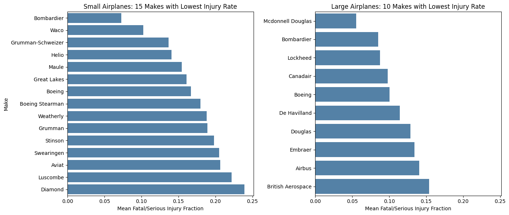
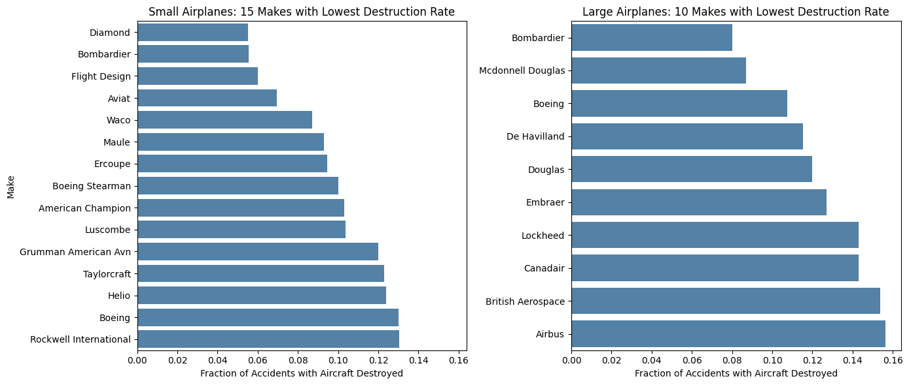
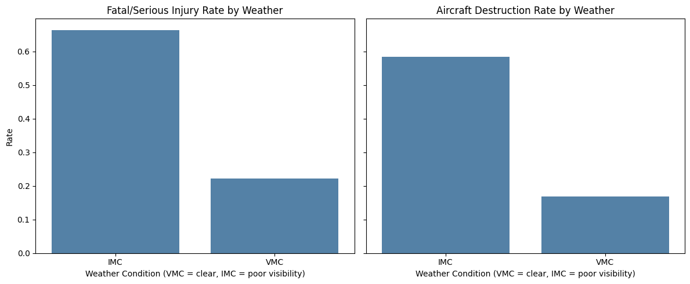
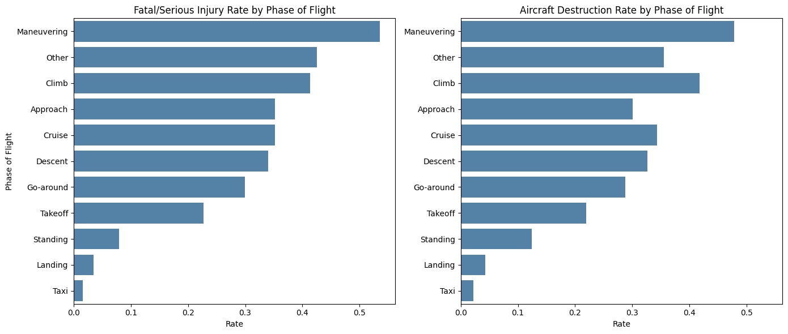

# Aviation Accident Analysis
**Completed Nov 18, 2026**
<br>
<br>
# Aviation Accident Analysis: Aircraft Safety Recommendations

## Overview
This project analyzes NTSB aviation accident data (1948–2023) for an airline/airplane insurer. The goal is to identify which aircraft **makes and models** have the **lowest rates of aircraft destruction** and the **lowest likelihood of fatal or serious injuries** when an accident occurs, and to identify **conditions that contribute to accident severity**. Recommendations are given separately for **small aircraft** and **large passenger aircraft**.

## Business Problem
The client is only interested in:
- **Airplanes** (not helicopters, gliders, balloons, etc.)
- **Professionally built** aircraft (not amateur/homebuilt)
- Aircraft that **could still be active**, assuming a 40-year maximum lifetime (accidents from **1983 onward**)

All comparisons use a **minimum sample size** so that conclusions are statistically reliable.

## Data
- **Source:** [Kaggle: Aviation Accident Database](https://www.kaggle.com/datasets/mos3santos/acidentes-de-aviao-at-2023) (NTSB accident records)
- **Raw data:** 88,889 accidents × 31 columns
- **Cleaned data:** 59,795 accidents × 32 columns (`data/AviationData_Cleaned.csv`)

## Methods

### Data Cleaning (`Aviation_Accidents_Cleaning.ipynb`)
- Filtered to accidents from 1983 onward, professionally built aircraft, and airplanes only.
- `Aircraft.Category` was missing for most records, so missing values were filled in using each manufacturer's most common category.
- Standardized manufacturer names (capitalization, company suffixes like "Corp"/"Inc", and spelling variations) and kept only Makes with 50+ accidents.
- Created a unique plane identifier (`Make.Model`), since model names repeat across manufacturers.
- Converted placeholder values ("Unknown", "UNK") to missing, and grouped rare categories.
- Dropped columns with 20,000 or fewer non-null values.

### Key Measures
- **Fatal/serious injury fraction:** (fatal + serious injuries) ÷ estimated total people on board.
- **Destroyed:** 1 if the aircraft was destroyed, 0 otherwise. Its mean gives the destruction rate.
- **Size:** each plane type is labeled **Large** if its typical (median) number of people on board is 20 or more, otherwise **Small**.

### Analysis (`Aviation_Accidents_Data_Analysis.ipynb`)
Grouped accidents by Make, Make + Model, weather condition, and phase of flight, comparing mean injury and destruction rates. Makes and plane types needed at least **10 accidents** in their size group to be included.

## Results

### Manufacturers



| Size | Recommended Make | Injury rate | Destroyed rate | Accidents |
|---|---|---|---|---|
| Small | **Maule** | 15.5% | 9.3% | 570 |
| Small | **Waco** | 10.3% | 8.7% | 138 |
| Small | **Aviat** | 20.7% | 7.0% | 230 |
| Large | **McDonnell Douglas** | 5.5% | 8.7% | 230 |
| Large | **Bombardier** | 8.5% | 8.0% | 75 |
| Large | **Boeing** | 10.0% | 10.7% | 810 |

### Specific Plane Types
- **Large:** Boeing 777 (0% injury rate, 24 accidents), the McDonnell Douglas MD-80 family (under 0.3%), and the Bombardier CL-600-2B19 regional jet (3.1%).
- **Small:** Grumman-Schweizer G-164A (6.2%, 59 accidents), Maule M-4-220C (10.8%, 37), and Grumman G-164A (12.2%, 335).

### Factor 1: Weather Condition


Accidents in **bad conditions (IMC, poor visibility)** are about **3 times more severe** than in clear conditions (VMC): 66% vs. 22% injury rate, and 58% vs. 17% destroyed. The effect holds for both small and large aircraft.

### Factor 2: Phase of Flight


**Maneuvering** (54% injury rate) and **climb** (41%) are the most dangerous phases. **Landing** has the most accidents but among the lowest severity (3.5% injury rate): frequency and severity are not the same thing.

## Recommendations
1. **Small aircraft:** Prioritize **Maule**, **Waco**, and **Aviat**, which combine low injury and destruction rates with solid sample sizes.
2. **Large aircraft:** Prioritize **Boeing** (especially the 777), **Bombardier**, and **McDonnell Douglas**.
3. **Weather risk:** Consider higher premiums or stricter pilot requirements (like instrument ratings) for **small aircraft operating in poor weather**.
4. **Operational risk:** Operations involving low-altitude **maneuvering** carry higher severity risk and could be priced accordingly.

## Limitations
- **People on board are estimated** from injury counts. Some reports only record injured people, which can overstate injury rates (this caused a few large aircraft, such as the Boeing 747, to be labeled small).
- **"Boeing" in the small group** is mostly Stearman biplanes recorded under the Boeing name, so it is not recommended as a small-aircraft Make.
- **Model names are recorded inconsistently** (for instance, "G164B" vs. "G-164B"), which splits some plane types into smaller groups.
- The data contains **accidents only**, not total flights, so it measures how severe accidents are, *not how often each aircraft has accidents*.
- Several top small plane types are **specialized aircraft** (like agricultural crop dusters), which may not match the client's insured fleet.

## Next Steps
- Standardize model names to combine variants of the same aircraft.
- Bring in data to calculate accident **frequency**, not just severity.
- Analyze additional factors such as engine type and purpose of flight.

## Repository Structure
```
├── data/
│   ├── AviationData.csv                    # raw data
│   └── AviationData_Cleaned.csv            # cleaned data (output of cleaning notebook)
├── images/                                 # saved visualizations
├── Aviation_Accidents_Cleaning.ipynb       # data cleaning
├── Aviation_Accidents_Data_Analysis.ipynb  # analysis and recommendations
└── README.md
```